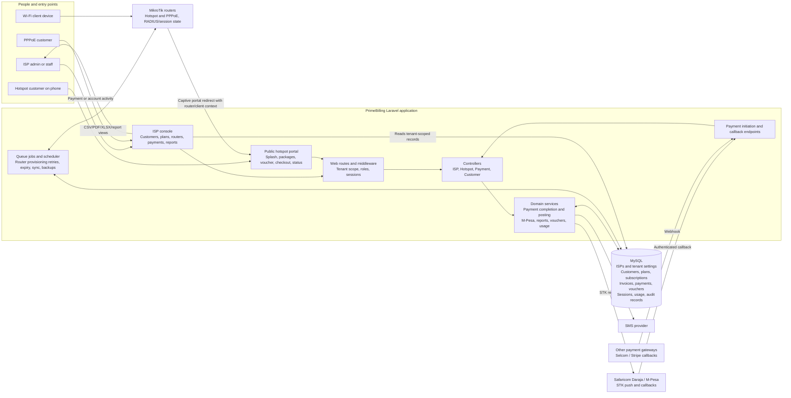
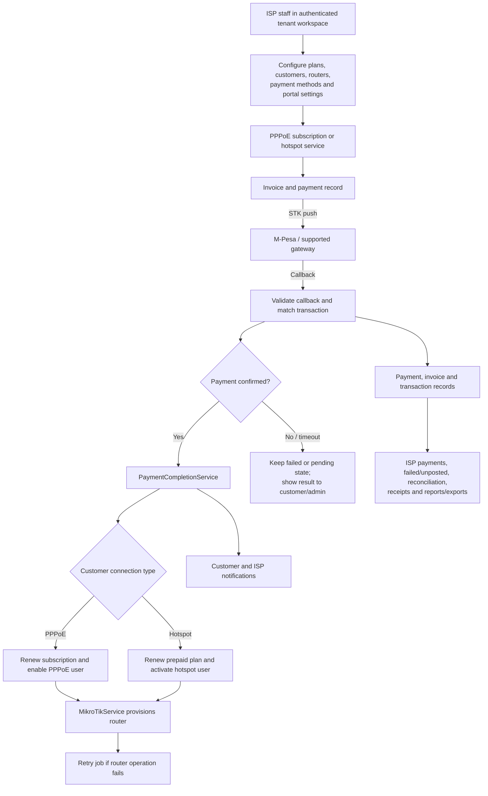

# ISP Billing & Hotspot System Architecture

This diagram follows the current Laravel application structure. The web console, public hotspot portal, payment callbacks, background jobs, database, and router integration are shown as distinct parts of one application.

## System context and components



## Hotspot purchase and activation

```mermaid
sequenceDiagram
    autonumber
    participant Phone as Customer phone
    participant Router as MikroTik hotspot router
    participant Portal as Hotspot portal
    participant DB as Application database
    participant Pay as M-Pesa Daraja
    participant Callback as Payment callback
    participant Complete as Payment completion service

    Phone->>Router: Join Wi-Fi without a valid session
    Router-->>Phone: Redirect to portal with router/client context
    Phone->>Portal: Open splash/packages page
    Portal->>DB: Resolve router, ISP, visible hotspot plans and portal settings
    DB-->>Portal: Plans, prices, Till/support details
    Portal-->>Phone: Compact package list; voucher and buy actions
    alt Redeem existing voucher
        Phone->>Portal: Submit voucher code
        Portal->>DB: Validate voucher and its tenant/router/plan
        Portal->>Router: Create/activate hotspot access
        Portal-->>Phone: Access/status result
    else Buy a package
        Phone->>Portal: Choose plan and enter phone number
        Portal->>DB: Create hotspot customer, pending subscription and invoice
        Phone->>Pay: Request STK push through application
        Pay-->>Phone: Show M-Pesa PIN prompt
        Pay->>Callback: Send payment result callback
        Callback->>DB: Match and record transaction/payment status
        Callback->>Complete: Complete confirmed payment (idempotently)
        Complete->>DB: Mark payment/invoice paid; renew subscription; activate customer
        Complete->>Router: Provision/enable hotspot user and apply limits
        Complete->>DB: Record activation outcome and payment side-effect marker
        Phone->>Portal: Poll signed payment status while modal verifies
        Portal->>DB: Read payment and activation state
        Portal-->>Phone: Success/access details, pending, cancelled, or failure state
        opt Router unavailable
            Complete-->>DB: Queue provisioning retry
        end
    end
```

## ISP admin and PPPoE billing flow



## Key data and separation

- `isp_id` scopes plans, customers, routers, invoices, payments, and portal configuration to an ISP workspace.
- Hotspot purchases create a customer with `connection_type = hotspot`; this lets payment processing and ISP reporting distinguish them from PPPoE customers.
- A payment is linked to its customer and invoice; the invoice links to the purchased subscription/plan. Confirmed payments trigger subscription renewal and router provisioning.
- Voucher redemption follows its own validation path and grants access without an STK transaction.
- Router commands and live connection state are external to the database; the app stores account, session, usage, and action records and synchronizes with MikroTik through `MikroTikService` and background jobs.
- Payment success is callback-driven. The browser's verification view polls application payment status; it does not itself confirm money received.
- ISP reports and exports read tenant-scoped payment, invoice, subscription, voucher, and session records. Reconciliation can compare gateway transaction records with service activation records.

## Source anchors

- Public portal routes: `routes/web.php` (`/hotspot/splash`, `/hotspot/packages`, `/hotspot/buy/{plan}`, voucher, status, and checkout access).
- Payment callbacks: `routes/api.php` (M-Pesa, Selcom, and Stripe webhook routes).
- Hotspot behavior: `app/Http/Controllers/Hotspot/PortalController.php`.
- Payment side effects: `app/Services/PaymentCompletionService.php` and `app/Services/PaymentPostingService.php`.
- Router integration: `app/Services/MikroTikService.php`.
- ISP reporting: `app/Http/Controllers/ISP/Web/ReportController.php` and `app/Services/IspReportBuilder.php`.
```
